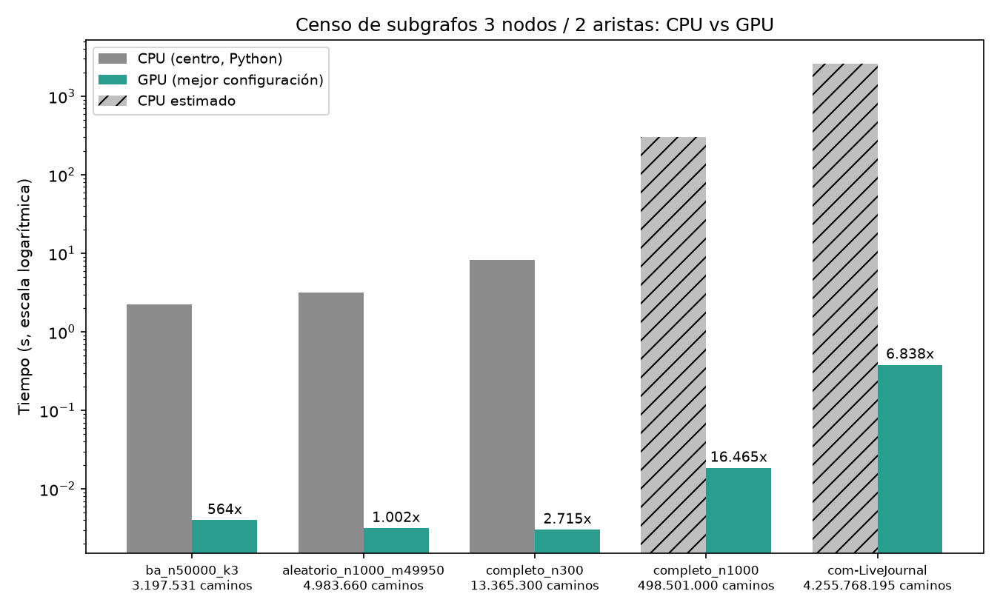

# Demo: censo de subgrafos de 3 nodos y 2 aristas (CPU vs GPU)

Fecha: 2026-10-26 19:48 | escala: completa | repeticiones: 3

## 0. Entorno

- python: 3.12.16
- sistema: Linux-6.6.87.2-microsoft-standard-WSL2-x86_64-with-glibc2.35
- numpy: 2.4.6
- numba: 0.68.0
- numba_cuda: 0.30.4
- pandas: 3.1.0
- cpu: Intel(R) Core(TM) i5-9400 CPU @ 2.90GHz
- ram_gb: 7.7
- gpu: NVIDIA GeForce RTX 5060
- capacidad_computo: 12.0
- vram_total_gb: 7.96
- vram_libre_gb: 6.85
- cuda_driver: 13.3

## 1. Validación de correctitud (CPU vs GPU, camino por camino)

Cada grafo se cuenta con los 2 métodos de CPU y con todas las configuraciones GPU válidas.
Además, la GPU emite el ID (par de aristas) de cada camino y se compara con el conjunto de la CPU.

| Grafo | Nodos | Aristas | Caminos | Patrones | CPU expl = centro | GPU configs OK | IDs GPU = CPU |
|---|---:|---:|---:|---:|---:|---:|---:|
| ejemplo | 6 | 7 | 13 | 7 | sí | 9/9 | OK (0 duplicados) |
| triangulo | 3 | 3 | 3 | 1 | sí | 9/9 | OK (0 duplicados) |
| estrella_n50 | 50 | 49 | 1.176 | 1 | sí | 9/9 | OK (0 duplicados) |
| ba_n300_k2 | 300 | 596 | 4.472 | 63 | sí | 9/9 | OK (0 duplicados) |
| aleatorio_n200_m600 | 200 | 600 | 3.590 | 312 | sí | 9/9 | OK (0 duplicados) |

## 2. Estrategias secuenciales: exploración (hash de IDs) vs centro (regla de pertenencia)

Tiempo = mejor de 3 repeticiones. La memoria se mide aparte con tracemalloc.

| Grafo | Caminos | Exploración | Centro | Aceleración | Mem. exploración | Mem. centro | Descartados (expl.) | Mismo censo |
|---|---:|---:|---:|---:|---:|---:|---:|---:|
| estrella_n1000 | 498.501 | 843.589 ms | 305.145 ms | 2,8x | 42,62 MB | 0,00 MB | 1.495.503 (75,0%) | sí |
| aleatorio_n10000_m50000 | 499.140 | 1.243 s | 356.121 ms | 3,5x | 42,67 MB | 0,02 MB | 1.497.420 (75,0%) | sí |
| ba_n20000_k3 | 1.183.346 | 2.796 s | 795.910 ms | 3,5x | 95,22 MB | 0,02 MB | 3.550.038 (75,0%) | sí |

## 3. CPU vs GPU sobre el mismo grafo

CPU = método centro (el mejor secuencial), mejor de 3 (1 si hay más de 5 M de caminos). GPU = promedio de 3 tras 1 ejecución de calentamiento; Total = H2D + cálculo + D2H.

ba_n50000_k3: 3.197.531 caminos, CPU centro 2.252 s

| Kernel | Conteo | Hilos | Lanz. | H2D | Kernel (cálculo) | D2H | Total | Desbal | OK |
|---|---:|---:|---:|---:|---:|---:|---:|---:|---:|
| nodo | global | 50.176 | 1 | 3.444 ms | 117.860 ms | 0.333 ms | 121.637 ms | 6.235,82 | sí |
| nodo | shared | 50.176 | 1 | 3.235 ms | 124.950 ms | 0.304 ms | 128.489 ms | 6.235,82 | sí |
| nodo | hash | 50.176 | 1 | 2.776 ms | 179.999 ms | 0.493 ms | 183.267 ms | 6.235,82 | sí |
| entrada | global | 300.032 | 1 | 3.931 ms | 1.112 ms | 0.156 ms | 5.198 ms | 83,60 | sí |
| entrada | shared | 300.032 | 1 | 4.036 ms | 0.894 ms | 0.155 ms | 5.086 ms | 83,60 | sí |
| entrada | hash | 300.032 | 1 | 4.043 ms | 1.196 ms | 0.324 ms | 5.563 ms | 83,60 | sí |
| balanceado | global | 50.176 | 1 | 3.048 ms | 1.010 ms | 0.210 ms | 4.268 ms | 1,00 | sí |
| balanceado | shared | 50.176 | 1 | 2.872 ms | 0.828 ms | 0.297 ms | 3.997 ms | 1,00 | sí |
| balanceado | hash | 50.176 | 1 | 3.088 ms | 1.051 ms | 0.324 ms | 4.463 ms | 1,00 | sí |

aleatorio_n1000_m49950: 4.983.660 caminos, CPU centro 3.172 s

| Kernel | Conteo | Hilos | Lanz. | H2D | Kernel (cálculo) | D2H | Total | Desbal | OK |
|---|---:|---:|---:|---:|---:|---:|---:|---:|---:|
| nodo | global | 1.024 | 1 | 4.143 ms | 4.718 ms | 0.292 ms | 9.153 ms | 1,67 | sí |
| nodo | shared | 1.024 | 1 | 1.797 ms | 4.564 ms | 0.221 ms | 6.582 ms | 1,67 | sí |
| nodo | hash | 1.024 | 1 | 2.904 ms | 8.213 ms | 0.446 ms | 11.563 ms | 1,67 | sí |
| entrada | global | 100.096 | 1 | 2.851 ms | 1.134 ms | 0.196 ms | 4.181 ms | 2,55 | sí |
| entrada | shared | 100.096 | 1 | 3.843 ms | 0.545 ms | 0.179 ms | 4.567 ms | 2,55 | sí |
| entrada | hash | 100.096 | 1 | 2.849 ms | 0.940 ms | 0.306 ms | 4.095 ms | 2,55 | sí |
| balanceado | global | 78.080 | 1 | 2.449 ms | 1.044 ms | 0.229 ms | 3.722 ms | 1,00 | sí |
| balanceado | shared | 78.080 | 1 | 2.366 ms | 0.616 ms | 0.184 ms | 3.166 ms | 1,00 | sí |
| balanceado | hash | 78.080 | 1 | 3.817 ms | 1.023 ms | 0.315 ms | 5.155 ms | 1,00 | sí |

completo_n300: 13.365.300 caminos, CPU centro 8.226 s

| Kernel | Conteo | Hilos | Lanz. | H2D | Kernel (cálculo) | D2H | Total | Desbal | OK |
|---|---:|---:|---:|---:|---:|---:|---:|---:|---:|
| nodo | global | 512 | 1 | 1.941 ms | 25.643 ms | 0.302 ms | 27.886 ms | 1,71 | sí |
| nodo | shared | 512 | 1 | 1.572 ms | 31.609 ms | 0.385 ms | 33.566 ms | 1,71 | sí |
| nodo | hash | 512 | 1 | 1.739 ms | 46.091 ms | 0.502 ms | 48.332 ms | 1,71 | sí |
| entrada | global | 89.856 | 1 | 2.026 ms | 1.469 ms | 0.183 ms | 3.678 ms | 2,00 | sí |
| entrada | shared | 89.856 | 1 | 2.190 ms | 0.816 ms | 0.193 ms | 3.199 ms | 2,00 | sí |
| entrada | hash | 89.856 | 1 | 2.249 ms | 1.690 ms | 0.335 ms | 4.273 ms | 2,00 | sí |
| balanceado | global | 208.896 | 1 | 1.842 ms | 1.508 ms | 0.160 ms | 3.510 ms | 1,00 | sí |
| balanceado | shared | 208.896 | 1 | 2.007 ms | 0.830 ms | 0.193 ms | 3.030 ms | 1,00 | sí |
| balanceado | hash | 208.896 | 1 | 1.890 ms | 1.457 ms | 0.325 ms | 3.671 ms | 1,00 | sí |

Resumen del experimento 3:

| Grafo | Caminos | CPU centro | Mejor GPU | Cálculo GPU | Total GPU | Aceleración | Censo = CPU |
|---|---:|---:|---:|---:|---:|---:|---:|
| ba_n50000_k3 | 3.197.531 | 2.252 s | balanceado + shared | 0.828 ms | 3.997 ms | 564x | sí |
| aleatorio_n1000_m49950 | 4.983.660 | 3.172 s | balanceado + shared | 0.616 ms | 3.166 ms | 1.002x | sí |
| completo_n300 | 13.365.300 | 8.226 s | balanceado + shared | 0.830 ms | 3.030 ms | 2.715x | sí |

## 4. GPU a gran escala (sin CPU: el tiempo de CPU se estima)

El tiempo de CPU se estima con el mejor rendimiento de 'centro' medido en esta máquina (caminos/s).

completo_n1000: 498.501.000 caminos | construcción del grafo (Python): 2.066 s | CPU centro estimado: 305.145 s

| Kernel | Conteo | Hilos | Lanz. | H2D | Kernel (cálculo) | D2H | Total | Desbal | OK |
|---|---:|---:|---:|---:|---:|---:|---:|---:|---:|
| nodo | global | 1.024 | 1 | 3.749 ms | 305.222 ms | 0.284 ms | 309.255 ms | 1,02 | sí |
| nodo | shared | 1.024 | 1 | 4.402 ms | 362.198 ms | 0.308 ms | 366.908 ms | 1,02 | sí |
| nodo | hash | 1.024 | 1 | 5.091 ms | 542.586 ms | 0.499 ms | 548.176 ms | 1,02 | sí |
| entrada | global | 999.168 | 1 | 5.965 ms | 73.698 ms | 0.345 ms | 80.008 ms | 2,00 | sí |
| entrada | shared | 999.168 | 1 | 5.538 ms | 12.743 ms | 0.251 ms | 18.532 ms | 2,00 | sí |
| entrada | hash | 999.168 | 1 | 6.190 ms | 49.953 ms | 0.487 ms | 56.631 ms | 2,00 | sí |
| balanceado | global | 1.048.576 | 1 | 4.534 ms | 83.813 ms | 0.307 ms | 88.655 ms | 1,08 | sí |
| balanceado | shared | 1.048.576 | 1 | 4.732 ms | 17.331 ms | 0.313 ms | 22.375 ms | 1,08 | sí |
| balanceado | hash | 1.048.576 | 1 | 5.037 ms | 72.013 ms | 0.434 ms | 77.483 ms | 1,08 | sí |

## 5. Grafo real masivo: com-LiveJournal (SNAP), solo GPU

Fuente: https://snap.stanford.edu/data/com-LiveJournal.html
Los grafos de SNAP no traen etiquetas: se asignan 5 etiquetas de nodo y 2 de arista al azar (uniformes, semilla 42).

- descarga: 24.229 s
- lectura: 6.311 s
- construccion csr: 47.648 s
- guardado cache: 1.314 s

Nodos: 3.997.962 | aristas: 34.681.189 (coincide con SNAP)
Grado máximo: 14.815 | caminos W = Σ C(d,2): 4.255.768.195 | espacio de patrones P: 500

Kernel 'nodo' omitido: un solo hilo tendría que procesar C(14.815, 2) = 109.734.705 caminos (desbalance teórico 27.038). Se usan 'entrada' y 'balanceado'.

Memoria GPU libre: 6,86 GB de 7,96 GB

| Kernel | Conteo | Hilos | Lanz. | H2D | Kernel (cálculo) | D2H | Total | Desbal | OK |
|---|---:|---:|---:|---:|---:|---:|---:|---:|---:|
| entrada | global | 1.048.576 | 5 | 192.169 ms | 447.480 ms | 0.539 ms | 640.188 ms | 4,72 | sí |
| entrada | shared | 1.048.576 | 5 | 179.591 ms | 200.880 ms | 0.505 ms | 380.976 ms | 4,72 | sí |
| entrada | hash | 1.048.576 | 5 | 189.130 ms | 452.041 ms | 0.656 ms | 641.827 ms | 4,72 | sí |
| balanceado | global | 1.048.576 | 5 | 135.209 ms | 407.723 ms | 0.493 ms | 543.425 ms | 1,01 | sí |
| balanceado | shared | 1.048.576 | 5 | 133.541 ms | 254.100 ms | 0.577 ms | 388.219 ms | 1,01 | sí |
| balanceado | hash | 1.048.576 | 5 | 125.668 ms | 523.752 ms | 0.705 ms | 650.125 ms | 1,01 | sí |

Mejor configuración: entrada + shared, 380.976 ms en total (21,2 mil millones de caminos/s en el cálculo).

CPU centro estimado para este grafo: 2605.062 s.

Patrones distintos: 275 | total = W: sí | top 5:

| Patrón | Frecuencia | % |
|---|---:|---:|
| C -[a]- B -[a]- D | 18.742.639 | 0,44% |
| D -[a]- B -[b]- D | 18.737.328 | 0,44% |
| D -[a]- B -[b]- B | 18.717.391 | 0,44% |
| D -[a]- B -[b]- A | 18.716.828 | 0,44% |
| B -[a]- B -[a]- D | 18.696.737 | 0,44% |

## 6. Resumen

| Grafo | Caminos | CPU centro | Mejor GPU | Total GPU | Aceleración |
|---|---:|---:|---:|---:|---:|
| ba_n50000_k3 | 3.197.531 | 2.252 s | balanceado + shared | 3.997 ms | 564x |
| aleatorio_n1000_m49950 | 4.983.660 | 3.172 s | balanceado + shared | 3.166 ms | 1.002x |
| completo_n300 | 13.365.300 | 8.226 s | balanceado + shared | 3.030 ms | 2.715x |
| completo_n1000 | 498.501.000 | 305.145 s (estimado) | entrada + shared | 18.532 ms | 16.465x |
| com-LiveJournal | 4.255.768.195 | 2605.062 s (estimado) | entrada + shared | 380.976 ms | 6.838x |

La aceleración compara contra Python puro; contra una CPU compilada la diferencia sería menor.

Duración total de la demo: 208.142 s

